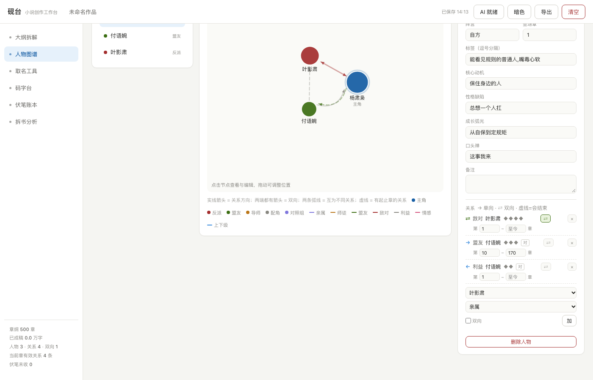
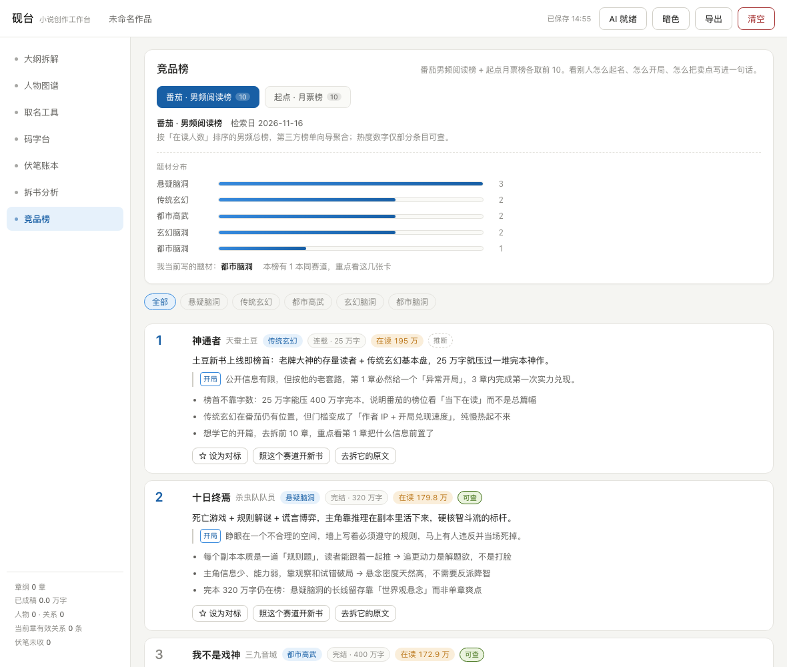
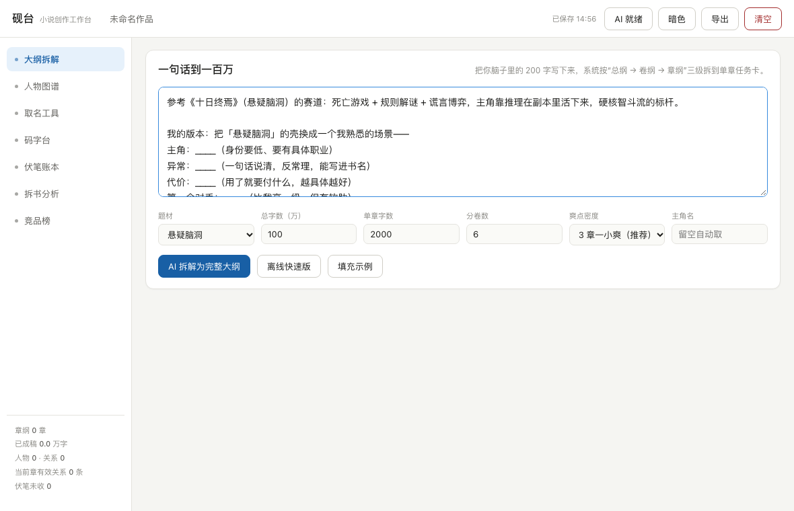
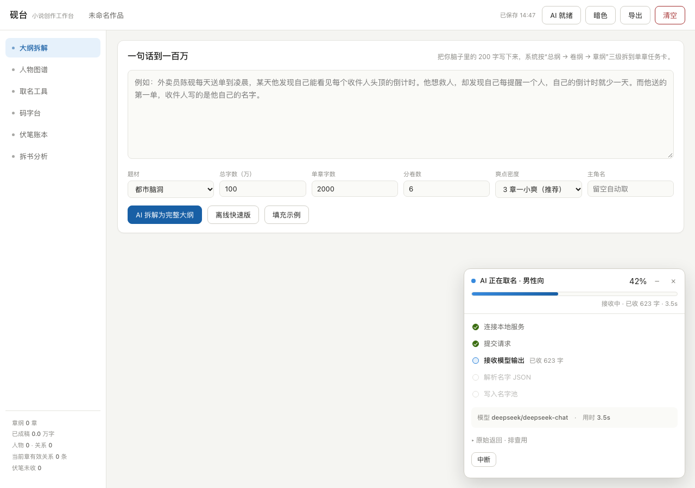
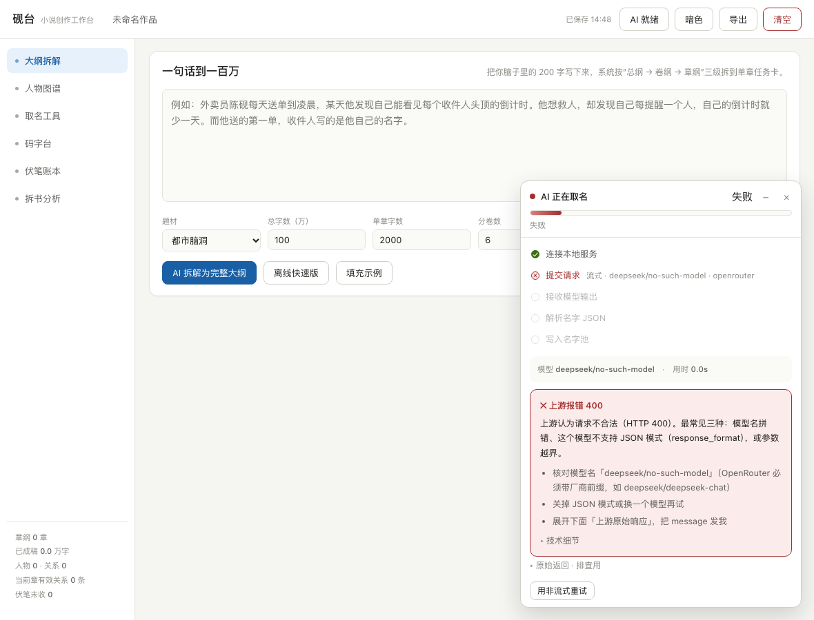

# 砚台 · 小说创作工作台

一个可离线运行的网文写作辅助原型。把 200 字灵感拆成三级大纲、管人物关系、批量取名、按章写正文。



<details>
<summary>其他界面截图（竞品榜 / 拆书 / AI 任务卡片）</summary>

| | |
|---|---|
|  |  |
|  |  |

</details>

## 运行

**方式一（推荐，含 AI 能力）**

```bash
cd novel-studio
node server.js
```

打开 http://127.0.0.1:8931 ，右上角「AI 设置」填 Key（会写入 `.llm-config.json`，权限 600，已在 `.gitignore` 里，不会被提交）。

> 克隆下来跑：先 `cp .llm-config.example.json .llm-config.json`，或直接用环境变量 `DEEPSEEK_API_KEY=sk-xxx node server.js`。

**方式二（纯本地，无 AI）**

双击 `index.html`。无需安装、无需联网，数据存浏览器 localStorage，但 AI 三个功能不可用。

演示参数：`?demo=1` 自动填示例并生成，`&view=chars` 直接看某一页。

## 数据安全与备份

数据只存在浏览器 localStorage 里，所以：

- 顶栏 **备份** = 完整 JSON（大纲、人物、关系、正文、伏笔、拆书），**导入** 可原样恢复；**导出 .md** 是给人读的，导不回来。换浏览器、清缓存、重装系统前先点一次「备份」。
- 关页签 / 切走时会立即落盘，不会再丢最后几个字；存储写满时顶栏会变红提示。
- 读档失败（存档损坏）时，原文会另存到 `yantai.novel.v1.corrupt`，不会被新存档覆盖。
- 重新生成大纲前，如果已有正文会先确认。

本地服务（`server.js`）持有你的 API Key，所以做了这些限制：只监听 127.0.0.1；静态文件走白名单（`.llm-config.json`、`server.js` 等读不到）；校验 Host / Origin（防 DNS 重绑定和别的网页跨站调用）；`/api/*` 的 POST 必须是 `application/json`；浏览器点「中断」会同时掐断上游请求。

```
npm test        # 服务端安全回归（零依赖）
```

## 接 AI（DeepSeek / OpenRouter）

| 入口 | 位置 | 作用 |
|---|---|---|
| **AI 拆解** | 大纲页 | 大模型生成核心设定、卷纲、人物关系、前 20 章细纲；第 21 章起由规则引擎按卷目标补齐，保证 500 章结构完整 |
| **AI 续写** | 码字台右上 | 按本章任务卡 + 登场人物卡 + 上章钩子写 2000 字，流式输出 |
| **AI 体检** | 核心设定右上 | 查战力越级、时间线冲突、动机断裂、伏笔不收 |

**配置 Key 两种方式**

1. 页面右上角「AI 设置」→ 选服务商 → 填 Key → 保存（写入 `.llm-config.json`，权限 600）
2. 命令行：`DEEPSEEK_API_KEY=sk-xxx node server.js`

**为什么需要 server.js**：DeepSeek 的接口不允许浏览器跨域直连，必须走本机代理；Key 也不该放在前端。OpenRouter 虽然允许跨域，但一样走代理，保证两条链路行为一致。

**模型选择**

- DeepSeek：`deepseek-chat` 日常写正文够用且便宜；`deepseek-reasoner` 拆大纲、做体检更稳，但慢
- OpenRouter：`deepseek/deepseek-chat` 性价比最高，也可切 `anthropic/claude-sonnet-4`、`google/gemini-2.5-pro`，输入框里可以手改模型名

**失败排查**

- 按钮显示「AI 未连接」→ 没启动 `server.js`，或端口不是 8931
- 401 / 402 → Key 无效或没有余额
- 「返回的不是合法 JSON」→ 换个模型重试，DeepSeek 的 JSON 模式最稳
- 生成很慢 → 拆大纲正常要 20–60 秒；正文按字数线性增长，2000 字约 40 秒

**AI 任务卡片（右下角常驻，不挡操作）**

调用 AI 不再弹模态框，任务跑到右下角一张常驻卡片里，**可以一边等一边切到别的功能页**（人物图谱、取名、拆书……），任务照常跑完：

- **标题行**：状态点（蓝＝跑动中、绿＝完成、红＝失败）+ 任务名 + 百分比 + 「–」收起 + 「×」关闭；点标题也能收起
- **收起态**：只剩一条小条（任务名 + 百分比 + 进度条 + 阶段），占 320px 宽，适合一边码字一边等
- **成功**：自动收成小条，5 秒后自行消失；想留证据就在 5 秒内展开
- **失败**：不会自动收，卡片会自己展开并停在那里，切页面也不影响，回来再看
- **× 关闭**：任务还在跑时点 × 会先中断请求再关窗

卡片内部结构：

| 区域 | 内容 |
|---|---|
| 进度条 | 百分比 + 阶段文案；接收阶段按「已收字数 / 预期字数」推进到 85%，解析与写入各占一段；完成转绿、失败转红 |
| 步骤列表 | 连接本地服务 → 提交请求 → 接收模型输出 → 解析结果 → 写入项目，逐项打勾；接收中实时显示已收字数，6 秒没新数据会提示「无新数据」 |
| 统计行 | 模型、用时、首字延迟、流片段数、正文字数、思考字数、finish_reason、token 用量、上游 request id |
| 原始返回 | 默认折叠，展开可看模型吐出来的原文（尾部 4000 字） |
| 结果区 | 「AI 体检」这类纯文本输出直接摊开显示，不用去翻原文 |
| 错误面板 | 一句话原因 + 2–3 条具体建议 + 「上游原始响应」+ 「技术细节」JSON（含 diag、token、finish_reason、上游片段） |
| 用非流式重试 | 失败后出现，跳过 SSE 直接用非流式再打一次 —— 专治「上游一个字节都不返回」 |

错误分类由 `AI.explain()` 翻译：`abort`（中断/超时）、`upstream`（按 400/401/403/404/429/402/5xx 分别给原因）、`empty`（再分「只输出推理」「length 截断」「content_filter 拦截」「上游零字节」「退出但内容为空」五种）、`network`（连不上本地服务）。

> 遇到报错时，把「技术细节」整段复制出来即可定位：`收到片段: 0` + `思考字数 > 0` 是推理模型把 token 花在思考上；`rawLines: 0` 是流里没有任何数据行；`finish_reason: length` 是 max_tokens 不够。


## 七个模块

### 1. 大纲拆解
输入 200 字 + 五个参数（题材 / 总字数 / 单章字数 / 分卷数 / 爽点密度），输出三级结构：

- **总纲**：一句话核心梗、金手指公式、核心冲突、三次大转折、暗黑时刻、结局
- **卷纲**：每卷的目标、对手层级、地图势力、人物弧光、卷末高潮，自动带上起止章号
- **章纲**：每章一张任务卡——视角 / 目标 / 阻碍 / 转折 / 爽点类型 / 章末钩子

算法链路：`200字 → 中文 n-gram 关键词提取（过滤虚词） → 生成核心设定 → 按叙事权重分配卷章数 → 逐章套用 14 类节拍模板（压迫/试探/冲突/打脸/收获/反转/揭秘/失去/扩张/休整/伏笔/高潮/结盟/背叛）→ 替换为本书的人物、地点、势力`

100 万字 / 2000 字每章 = 500 章，分 6 卷时卷章数按钟形权重分配（中段长、首尾短）。

### 2. 人物图谱
人物卡字段：姓名、马甲、定位、阵营、标签、动机、缺陷、成长弧光、口头禅、登场章、备注。
关系支持 7 种类型 + 强度，力导向图自动布局，可拖拽。

**关系是有方向的**，图谱上直接画出来：

| 画法 | 含义 |
|---|---|
| 单箭头 | 单向关系，如「A 利用 B」 |
| 两端都有箭头 | 双向同质关系，如「互相敌对」 |
| 两条分开的弧线 | 两人之间是两段性质不同的关系，如「A 视 B 为盟友，B 只把 A 当筹码」 |

人物卡里每条关系左侧有方向符号（`→` / `←` / `⇄`），右侧 `⇄` 按钮一键切换单向／双向；新增关系时可勾选「双向」。若反向已存在同类型关系，置为双向时自动合并，不会出现两条重复的线。

**关系带起止章**：每条关系记 `fromCh`（建立章）和 `toCh`（结束章，留空 = 至今）。人物卡里直接改数字，图谱会跟着变——有 `toCh` 的关系画成虚线，表示"这段关系会断"。

**同一对人物可以分多段**，这就是状态机。点分段行上的「断」，填「第 N 章起改为 X」，系统自动把这一段在 N 章切开：前段 `toCh = N-1` 保持原性质，后段从第 N 章起换成新性质。人物卡里显示成缩进的分段列表，带「2 段」徽标，当前章生效的那段高亮。

```
⇄ 雷幽夜  [敌对 ◆◆◆◆]  第 1 – 至今 章
→ 谢澈缇  [2 段]
    盟友 ◆◆◆   第 10 – 170 章
    敌对 ◆◆◆◆  第 171 – 至今 章   ← 当前
← 谢澈缇  [利益 ◆◆]    第 1 – 至今 章
```

拖滑块到第 100 章，箭头是绿色盟友；拖到第 200 章，同一对已经变成红色敌对。不用手写两条记录，也不用记"我当初是从哪章翻的脸"。

**章节滑块**是本项目相对市面工具的差异点：拖动"截至第 N 章"，人物按登场章过滤，关系按生命周期过滤。拖到第 100 章看到的是"这时候他们还是盟友"，拖到第 300 章那条线已经消失，只剩一方的单方面利益关系。用来检查"这个角色是不是出现得太早"、"这段翻脸有没有铺垫"。

AI 拆解大纲时也会给出 `fromCh` / `toCh`，并要求"会翻脸的关系必须给一个在剧情上说得通的转折点章号"。

### 3. 取名工具
八类：人名 / 家族 / 宗门谱系 / 地名 / 宗门名 / 功法招式 / 组织公司 / 书名。每类都有两条路：**字库随机**（离线、秒出、不花钱）和 **AI 生成**（带释义，质量高一档）。

人名支持按气质（冷峻、儒雅、锋锐、温和、阴鸷、现代）、性别感、名字长度、姓氏类型（常见／古风／复姓）约束，并支持**避讳字**。
单击复制，双击：人名直接进人物库，其他进收藏。

**家族谱系**：按字辈诗逐代生成，`姓 + 字辈 + 单字`，可设姓氏、字辈诗、世代数（3–6）、每代人数（2–5）、名字气质。输出为一张谱系表，一眼看出"哪一辈是谁"。

**宗门谱系**：按字派诗分五层——掌门 1 / 首座长老 2 / 真传弟子 3 / 内门弟子 4 / 外门弟子 5，道号用字跨层去重。

两个谱系都有「全部加入人物库」：批量建人物，并自动连关系——家族按"长辈→晚辈"单向、同辈横向双向；宗门按"掌门→各层"师徒单向。

**AI 取名**会把当前题材、偏好、已有主要人物名一起喂给模型（避免撞音撞字），返回 `{text, sub}` 列表；谱系模式返回整棵族谱／宗门树，字辈诗和字派由模型自己拟。提示词里明确要求「示例 JSON 里的名字一个都不许直接用」，否则模型会照抄示例。

### 4. 码字台
左侧卷/章目录，中间正文区（实时字数），右侧本章任务卡——目标、阻碍、转折、爽点、钩子、可能出场的人、该结算的伏笔、上一章钩子。写的时候不用来回翻大纲。

### 5. 伏笔账本
记录埋设章与计划回收章，逾期未收自动标红。

### 6. 拆书分析
上传 txt / md / docx，反推一本已有小说的结构。**结论由 AI 出，本地只做预处理。**

本地做的事（都是结构性的，不涉及"猜内容"）：
- **自动切章**：识别「第X章」「1.」「Chapter N」「楔子 / 序章 / 尾声」；没有标记就按 3000 字硬切
- **每章指标**：字数、对话占比、章末钩子强度、爽点密度
- **节奏曲线**：每章一根柱，连续三章低分自动标红（断期待区间）

AI 做的事（上传后自动触发，也可点「AI 重新拆解」重跑）：
- 赛道判断、核心卖点、开篇设计、节奏规律
- **人物配置**：姓名 + 定位 + 承担什么功能 + 动机，只认正文里真实出现过的人
- **关系张力**：谁和谁、什么性质、张力在哪
- 可复用套路、这本书踩的坑、写同赛道最该学的三件事

拆出来的「人物与关系」可以一键入库：确认名单后写进人物图谱，重复人名自动跳过。

> 本地那套「按对话归属统计人名」不再当主角，降级成一行附注。理由很直接：正则只能数名字出现几次，判断不出谁是主角、谁只是被提了一句。词频堆上去的名字经常是"老周说"里的老周，而不是真正推动剧情的人。

docx 解析是自己写的 zip 解包（`DecompressionStream`），不依赖第三方库。txt 先试 UTF-8，乱码率超过 0.5% 自动切 GBK。

### 7. 竞品榜
番茄男频阅读榜 + 起点月票榜，各取前 10，用来回答「别人怎么写的」。

- **两个榜、两种口径**：番茄按「在读人数」（当下的读者量），起点按「月票」（愿意花钱投票的核心盘）。同一本书在两边排位经常不一样，看你要的是拉新还是黏性
- **题材分布条**：一眼看出这期榜单哪个赛道挤（番茄这期是悬疑脑洞 3 本），并自动对照你当前写的题材 —— 本榜没有同赛道会直接提示「是否选错了池子」
- **每张卡四段**：一句话卖点 → 开局钩子 → 3 条可学点 → 三个动作
- **置信度标签**：`可查`（设定玩法公开可查）／`推断`（只按书名、分类、榜单位置推断，没读原文）。不给推断的内容假装是事实
- **三个动作**：「设为对标」（存进「我的对标」，跨榜共存）；「照这个赛道开新书」（把题材对齐到大纲页，并填一张带空格的模板：主角 / 异常 / 代价 / 第一个对手 / 第一个任务）；「去拆它的原文」（跳到拆书分析，让你上传真书）

数据是静态内置的（`rank.js`），因为榜单每天变、也不该让浏览器去爬站点。更新方式：改 `RANK_BOARDS` 里的 `items` 和 `asof` 两处即可。

## 还能加什么

**P0（已实现）**：大纲拆解、人物图谱、取名、码字台、伏笔账本、节奏体检、拆书分析、竞品榜

**P1（建议下一步）**
- 一致性检查：等级越级、时间线冲突、人物口吻漂移
- 章节摘要自动生成 + 跨章记忆，防"吃书"
- 书名/简介 A/B 生成器（对应番茄"书测"机制）
- 导出番茄后台格式 + 敏感词提示

**P2（进阶）**
- 一致性检查升级为自动修正（现在只报问题，不改稿）
- 时间线与地图编辑器
- 小说转短剧分集稿

## 与市面产品的差异

| 能力 | 蛙蛙写作 / 唐库 / 笔灵 | 创宙工坊 / 织网 | 本项目 |
|---|---|---|---|
| 大纲拆解 | 强，接入大模型 | 弱 | 规则引擎，结构精确到章，离线可用 |
| 人物图谱 | 弱 | 强，静态图 | 强，按章节回看演化；关系带方向、带起止章、可分段，同一对能从盟友变敌对 |
| 取名 | 弱，散落在通用模型里 | 无 | 独立工具，字库 + AI 双通道；支持避讳；家族字辈 / 宗门字派成体系出 |
| 节奏体检 | 部分有 | 无 | 逐章热力图，自动标"断期待"区间 |
| 伏笔追踪 | 部分有 | 部分有 | 有，且与码字台联动提醒 |
| 拆书反推 | 强，接大模型 | 无 | 本地只切章出指标，人物/关系/套路全由 AI 判断，可直接入库 |

## 已知限制

- 大纲拆解有两种引擎：主按钮「AI 拆解为完整大纲」走**大模型**（内容质量高，20–60 秒）；「离线快速版」走**规则引擎**（无网无 Key 也能用，结构精确到章但内容套路）。AI 只生成前 20 章细纲，其余按节拍补齐——一次让模型吐 500 章必然崩，这是刻意的取舍。
- AI 生成的正文仍需你改。模板和模型都只是脚手架，情绪和判断还是你的。
- 章标题从 30 个模板里循环，500 章会重复，正式写时替换。
- 数据只存在本机浏览器（localStorage，约 5MB 上限；100 万字约占 1/5，超过 300 万字会写满）。定期点「备份」。后续计划迁到 IndexedDB。
- 重新生成大纲不会清空已写正文，但章号可能错位（已加确认提示），改参数前先备份。
- 同一时间只允许一个 AI 任务（任务卡片是全局唯一的）。
- 分段只能按时间线性排列，不支持"同一时期既是盟友又是敌人"这种叠加态。真需要就拆成两条不同方向的记录（A→B 盟友、B→A 利益）。
- 断代不做反向推导：把后段删掉不会自动把前段的 `toCh` 补回空，还得手动改。
- AI 取名依赖模型，同一批结果不会重复但也不保证风格统一；批量定稿前建议人工过一遍。
- 拆书一次最多读前 60 章目录 + 前三章正文，很长的书只能代表开篇，中后期结构要分段上传。

## 调试用 URL 参数

| 参数 | 作用 |
|---|---|
| `?view=outline\|chars\|names\|write\|foreshadow\|analyze` | 直接打开某个视图 |
| `?demo=1` | 一键灌入示例项目（都市高武） |
| `?view=names&nk=family` | 打开取名页并切到指定标签（`person` / `family` / `sectline` / `place` / `sect` / `skill` / `org` / `title`） |
| `?theme=dark` / `?theme=light` | 强制主题 |
| `?view=chars&ch=100` | 打开人物图谱并把章节滑块拉到第 100 章（看关系演化） |

## 文件

```
index.html   界面骨架
app.css      样式（支持明暗切换）
data.js      字库、题材词包、叙事模板池
ai.js        LLM 客户端、提示词、JSON 容错解析
analyze.js   拆书：txt/docx 解析、切章、指标、人物提取
rank.js      竞品榜：番茄/起点 TOP10 数据与渲染
app.js       状态管理、拆解引擎、图谱、取名、码字
server.js    本地服务：静态托管（白名单）+ LLM 代理（node server.js）
test/        服务端安全回归（npm test）
```

Key 存在同目录 `.llm-config.json`，已排除在分享范围外，不要提交到任何仓库。
